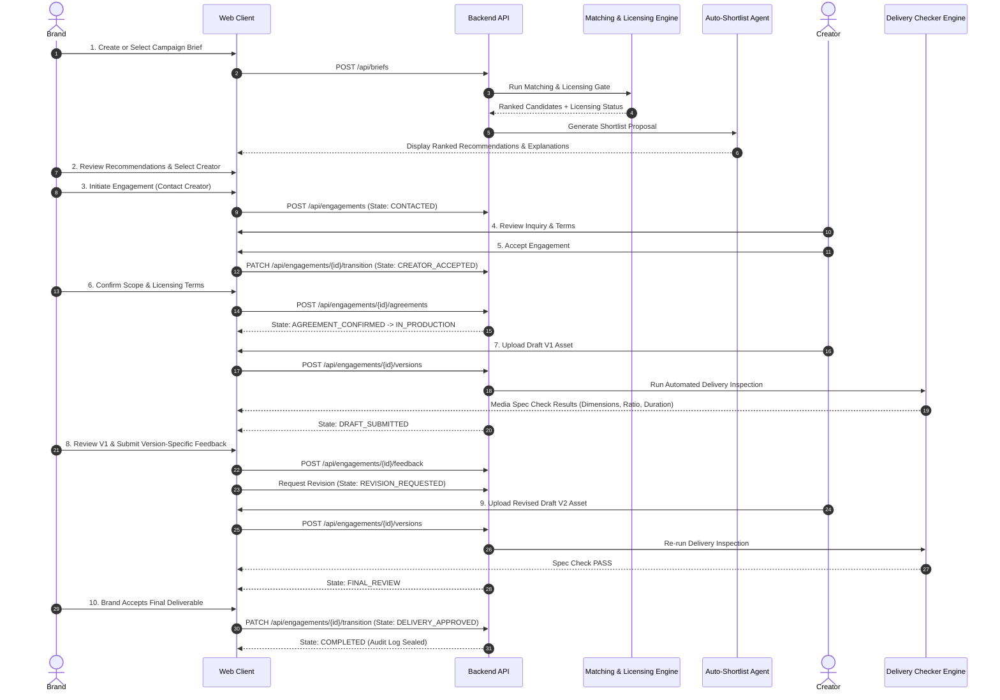

# 03 — Product User Flows

## 1. End-to-End Golden Path Workflow

---

## 2. Brand User Journeys

### Journey 1: Brief Creation to Candidate Shortlist
1. Brand navigates to Brief Builder or selects an active brief from the marketplace feed.
2. The brand inputs technical specs: Aspect ratio (`9:16`), Content type (`Video`), Duration (`0:15`), Commercial rights (`Full Buyout`, Worldwide, Paid Ads).
3. The Matching Engine returns ranked candidates.
4. If licensing terms conflict, the system flags `MISMATCH` with detailed conflict points.
5. Brand adds compatible candidates to their active Shortlist.

### Journey 2: Contract Formalization & Revision Review
1. Brand selects a shortlisted creator and reviews the proposed engagement terms.
2. Both parties confirm scope, delivery dates, and licensing rights.
3. Creator submits Draft V1.
4. Brand inspects the delivery check output (e.g., verifying if the video is vertical 9:16 and under 15 seconds).
5. Brand adds frame-anchored feedback requesting audio tweak or motion adjustment.
6. Creator uploads V2; brand reviews and triggers final delivery approval.

---

## 3. Creator User Journeys

### Journey 1: Receiving & Responding to Inquiries
1. Creator logs into their Creator Studio and views Incoming Opportunities.
2. Inquiries display requested budget, brief details, and requested licensing scope.
3. Creator can **Accept**, **Decline** (with reason), or request clarification.
4. Once accepted, engagement transitions to Scope Confirmation.

### Journey 2: Draft Submission & Feedback Resolution
1. Under active production, creator uploads draft files with detailed generation notes (models, prompts, tools).
2. The platform performs an instant file delivery check, warning the creator if aspect ratio or resolution does not match the brief.
3. Creator resolves version-anchored feedback items as they are addressed.
4. Creator submits the final revised master deliverable.
