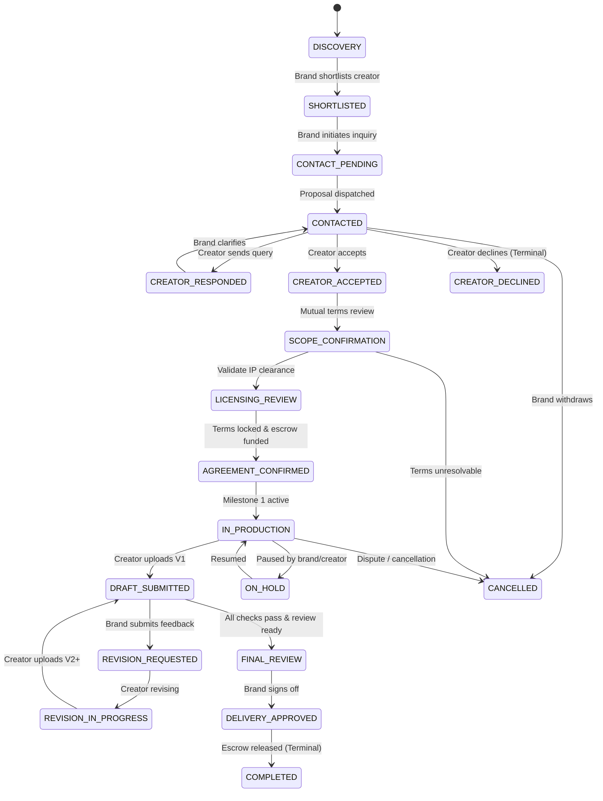

# 10 — Engagement State Machine

## 1. Complete 19-Stage State Machine

The engagement lifecycle is modeled as a strictly validated Finite State Machine (FSM):

---

## 2. Valid Transition Table & Role Guards

| Current State | Target State | Authorized Actor | Prerequisites / Validation Checks |
|---|---|---|---|
| `DISCOVERY` | `SHORTLISTED` | Brand | Valid `creatorId` exists. |
| `SHORTLISTED` | `CONTACT_PENDING` | Brand | Brief attached or custom title + budget set. |
| `CONTACT_PENDING` | `CONTACTED` | System / Brand | Inquiry message validated. |
| `CONTACTED` | `CREATOR_ACCEPTED` | Creator | Must be the assigned creator. |
| `CONTACTED` | `CREATOR_DECLINED` | Creator | Decline reason recorded. |
| `CREATOR_ACCEPTED` | `SCOPE_CONFIRMATION` | Brand / Creator | Milestone amounts and timeline defined. |
| `SCOPE_CONFIRMATION`| `LICENSING_REVIEW` | Brand | Licensing terms checklist submitted. |
| `LICENSING_REVIEW` | `AGREEMENT_CONFIRMED` | Brand | Licensing status must be `COMPATIBLE` or explicitly overridden with human review sign-off. |
| `AGREEMENT_CONFIRMED`| `IN_PRODUCTION` | System / Brand | Escrow funded or milestone contract sealed. |
| `IN_PRODUCTION` | `DRAFT_SUBMITTED` | Creator | Draft file reference, checksum, and notes provided. |
| `DRAFT_SUBMITTED` | `REVISION_REQUESTED` | Brand | At least 1 feedback comment anchored to current version. |
| `REVISION_REQUESTED`| `REVISION_IN_PROGRESS`| Creator | Creator acknowledges feedback. |
| `REVISION_IN_PROGRESS`| `DRAFT_SUBMITTED`| Creator | New version incremented (`v2`, `v3`...). |
| `DRAFT_SUBMITTED` | `FINAL_REVIEW` | Brand | Delivery check engine status reviewed. |
| `FINAL_REVIEW` | `DELIVERY_APPROVED` | Brand | Mandatory checks verified; brand signs off. |
| `DELIVERY_APPROVED` | `COMPLETED` | System / Brand | Final escrow released and audit log sealed. |
| *Any non-terminal* | `CANCELLED` | Brand / Admin | Cancellation reason recorded. |

---

## 3. Server-Side Guard Logic
State transitions are evaluated via pure backend functions. Invalid transitions reject with `HTTP 409 Conflict` and `INVALID_STATE_TRANSITION`, returning the current state, allowed next states, and missing prerequisites.
