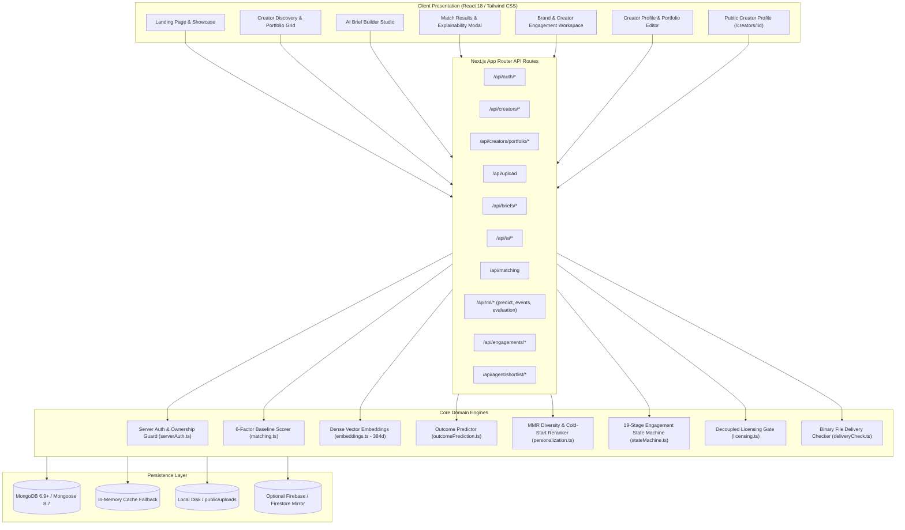
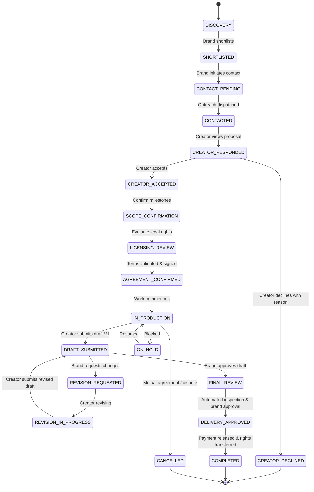

# GenCraft — System Architecture

GenCraft is an enterprise-grade AI Content Creator Marketplace connecting brands and creative agencies with vetted Generative AI directors and artists. The platform provides end-to-end management of the creator lifecycle: from brief generation and hybrid ML matching to commission proposals, contract licensing, draft versioning, physical binary delivery inspection, and brand sign-off.

---

## 1. High-Level Subsystem Architecture

GenCraft is built on **Next.js 14 App Router**, **TypeScript**, **MongoDB / Mongoose**, and **Multi-Engine AI Integration** (Groq Llama-3.3 70B, Google Gemini 1.5, and local deterministic fallback models).

---

## 2. Authentication & Authorization Boundaries

### Session & Identity Flow
- **Authentication**: Native session management via HTTP cookies (`gencraft_session`), Bearer headers, and Firebase Auth UID mapping.
- **Server-Side Enforcement**: All mutations on creator profiles, portfolios, engagements, and proposals pass through [serverAuth.ts](../src/lib/serverAuth.ts).
- **Role-Based Access Control (RBAC)**:
  - `brand`: Can create briefs, initiate engagements, submit review feedback, accept/reject drafts, approve final deliveries, and close engagements.
  - `creator`: Can update their profile, add/edit/delete portfolio projects, accept/decline commission proposals, submit deliverable draft versions, and mark feedback items as addressed.
- **Ownership Verification**:
  - Profile updates (`PUT /api/creators/profile`) verify that the active user matches the creator record.
  - Portfolio project mutations (`/api/creators/portfolio/:itemId`) verify that the project belongs to the creator's portfolio.
  - Engagement state transitions enforce that creators cannot transition proposals belonging to other creators, and brands cannot trigger creator-only actions (`CREATOR_ACCEPTED`, `CREATOR_DECLINED`).

---

## 3. Engagement Lifecycle State Machine (19 Stages)

Campaign engagements progress through a strictly guarded finite state machine defined in [stateMachine.ts](../src/lib/stateMachine.ts):

### Transition Integrity & Guards
1. **Role Authority**: Only assigned parties can execute specific actions. Brands cannot submit drafts; creators cannot self-approve final deliveries.
2. **Terminal State Immutability**: States `CREATOR_DECLINED`, `COMPLETED`, and `CANCELLED` cannot be transitioned out of.
3. **Idempotence**: Redundant transition requests to the current state are safely handled without corrupting audit history.
4. **Concurrency Safety**: Stale or mismatched transitions return `409 CONFLICT`.

---

## 4. Immutable Revision History & Review Ledger

- **Zero Overwrite Policy**: Every deliverable submitted by a creator creates a distinct, immutable version record (`v1`, `v2`, `v3`...) with a unique ID, timestamp, media URL, binary SHA-256 checksum, and creator notes.
- **Point-in-Time Feedback**: Review comments are explicitly anchored to a deliverable version ID with optional spatial coordinates `(x, y)` or video timestamp offsets `(e.g., 00:08)`.
- **Resolution Tracking**: Feedback entries maintain a lifecycle (`OPEN` → `ADDRESSED` → `ACCEPTED`).
- **Contractual Revision Guard**: The state machine tracks total revision rounds against the contracted `maxRevisions` allowance agreed upon in `SCOPE_CONFIRMATION`.

---

## 5. Physical Binary Media Delivery Inspection

Rather than accepting user-declared metadata, the delivery checker engine ([deliveryCheck.ts](../src/lib/deliveryCheck.ts)) parses raw binary file headers:

1. **Images (PNG, JPEG, WebP, GIF)**:
   - Reads SOF markers (JPEG `0xFF 0xC0`), IHDR chunks (PNG), and VP8/VP8X chunks (WebP).
   - Validates dimensions (width × height), exact aspect ratio, file size, and decodability.
2. **Videos (MP4, MOV, QuickTime)**:
   - Traverses ISO-BMFF box structures (`ftyp`, `moov`, `mvhd`, `tkhd`).
   - Extracts exact timescale, duration in seconds, container format, and display dimensions.
3. **Compliance Checking**:
   - Compares media metrics against campaign brief requirements (e.g., `9:16` vertical aspect ratio, `1080x1920` resolution, `<= 15s` duration).
   - Returns deterministic evaluation: `PASS`, `FAIL`, `WARNING`, or `UNVERIFIABLE`.
   - **Human Sign-Off Gate**: Automated check results provide evidence; final acceptance strictly requires human brand authorization.

---

## 6. Privacy & Data Boundaries

- **Public Creator Profiles (`/creators/:id`)**:
  - Projects marked `private` are stripped server-side before returning to public clients.
  - Direct contact email addresses are withheld unless the authenticated requester is the creator themselves.
- **Direct Upload Security (`/api/upload`)**:
  - Validates magic byte signatures (rejecting disguised executables or spoofed MIME types).
  - Enforces 15 MB limit for image assets and 50 MB limit for video deliverables.
  - Sanitizes file paths before writing to disk.

---

## 7. AI Provider Integration & Resilience

GenCraft uses a multi-provider AI architecture ([provider.ts](../src/lib/ai/provider.ts)):
1. **Primary Cloud Inference**: Groq (Llama-3.3 70B Versatile) for high-speed brief generation and analysis.
2. **Secondary Cloud Inference**: Google Gemini 1.5 Flash as an automatic failover.
3. **Deterministic Platform Engine (`gencraft-neural-engine`)**: Zero-network local fallback generating structured, grounded briefs and explanations if external API quotas expire or network connectivity is unavailable.
