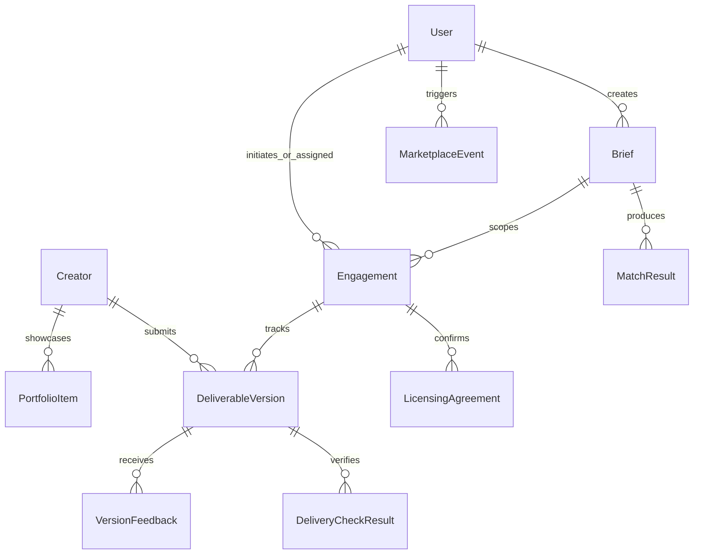

# GenCraft — Data Models & Persistence

GenCraft uses **MongoDB with Mongoose schemas** as its primary persistent store, coupled with an in-memory repository mirror for local resilience.

---

## 1. Entity Relationship Model

---

## 2. Core Mongoose Models & Schemas

### 1. `User` Model (`src/lib/models/User.ts`)
Stores platform identity, credentials, roles, and profile references.
- **Fields**:
  - `id` (String, unique, indexed): Unique platform ID.
  - `email` (String, unique, indexed): Primary login identifier.
  - `passwordHash` (String): Secure hashed password.
  - `name` (String): Display name.
  - `role` (String, enum: `brand`, `creator`, `agency`, `admin`): RBAC role.
  - `avatar` (String): Profile image URL.
  - `creatorProfileId` (String, optional): Foreign key to `Creator` record for creator accounts.
  - `brandDetails` (Object): Company name, website, and industry for brand accounts.
- **Indexes**: `{ email: 1 }` (unique), `{ id: 1 }` (unique).

### 2. `Creator` Model (`src/lib/models/Creator.ts`)
Stores vetted creator profiles, tool capabilities, verification audits, and portfolio items.
- **Fields**:
  - `id` (String, unique, indexed): Primary identifier (e.g., `creator-1`).
  - `name` (String, indexed): Full creator name.
  - `headline` (String): Short professional title.
  - `handle` (String): Unique handle (`@karthik_director.ai`).
  - `bio` (String): Biography and creative philosophy.
  - `location` (String, indexed): City and state.
  - `skills` (Array of Strings): Specialized creative techniques.
  - `tools` (Array of Strings, indexed): Certified AI models (`Veo`, `Kling`, `Sora`, `Flux.1`, `ElevenLabs`).
  - `hourlyRate` (Number): Standard commercial hourly rate in INR.
  - `isVerified` (Boolean): Verification badge status.
  - `verifiedDetails` (Object): Audit date, certified pipeline tier, and safety audit score.
  - `portfolio` (Array of `PortfolioItem` subdocuments): Project showcases.
  - `licensingTerms` (Object): Permitted territories, channel rights, duration, and exclusivity.
  - `completeness` (Number): Real-time calculated completeness percentage (`0-100`).
- **`PortfolioItem` Subdocument**:
  - `id` (String): Unique item identifier (`port-1`).
  - `title` (String): Project title.
  - `description` (String): Technical and narrative description.
  - `mediaUrl` (String): Direct URL to image or video deliverable.
  - `thumbnailUrl` (String): Preview image URL.
  - `mediaType` (String, enum: `image`, `video`).
  - `category` (String): Creative vertical (e.g., `Automotive`, `Skincare`, `Sci-Fi`).
  - `style` (String): Visual aesthetic (e.g., `Cinematic`, `Photorealistic`).
  - `skills` (Array of Strings): Specific tools and methods utilized.
  - `featured` (Boolean): Highlighted on top of creator profile.
  - `visibility` (String, enum: `public`, `private`): Public or owner-only access.
- **Indexes**: `{ id: 1 }` (unique), `{ tools: 1 }`, `{ location: 1 }`, `{ isVerified: 1 }`.

### 3. `Brief` Model (`src/lib/models/Brief.ts`)
Stores campaign brief specifications generated by brands or AI co-pilots.
- **Fields**:
  - `id` (String, unique, indexed): Unique brief ID (e.g., `brief-1`).
  - `brandId` (String, indexed): Foreign key to the creating `User`.
  - `title` (String): Campaign title.
  - `brandName` (String): Brand or agency name.
  - `contentType` (String): `Short Video`, `Commercial`, `Social Media Reel`, etc.
  - `aspectRatio` (String): `9:16`, `16:9`, `1:1`.
  - `duration` (String): `15s`, `30s`, `60s`.
  - `budget` (Number): Total campaign budget in INR.
  - `timeline` (String): Target completion duration.
  - `requiredTools` (Array of Strings): Mandatory AI models.
  - `requiredLicensing` (Object): Usage channel, territory, duration, and exclusivity.
  - `status` (String, enum: `draft`, `active`, `matched`, `closed`).
- **Indexes**: `{ id: 1 }` (unique), `{ brandId: 1 }`, `{ status: 1 }`.

### 4. `Engagement` Model (`src/lib/models/Engagement.ts`)
Manages the complete 19-stage lifecycle between a brand and a creator.
- **Fields**:
  - `id` (String, unique, indexed): Unique engagement ID (e.g., `eng-1`).
  - `briefId` (String, indexed): Associated campaign brief.
  - `brandId` (String, indexed): Brand participant.
  - `creatorId` (String, indexed): Creator participant.
  - `state` (String, indexed): Current FSM state (`DISCOVERY` through `COMPLETED`).
  - `budget` (Number): Agreed commercial compensation.
  - `deadline` (Date): Campaign completion target.
  - `scope` (String): Detailed deliverables description.
  - `deliverableVersions` (Array of `DeliverableVersion` subdocuments): Submitted drafts.
  - `versionFeedback` (Array of `VersionFeedback` subdocuments): Timestamped review notes.
  - `licensingAgreement` (Object): Legally binding terms confirmed by both parties.
  - `auditTrail` (Array of Objects): Immutable transition timestamps, actors, and reasons.
- **Indexes**: `{ id: 1 }` (unique), `{ briefId: 1 }`, `{ brandId: 1 }`, `{ creatorId: 1 }`, `{ state: 1 }`.

### 5. `MarketplaceEvent` Model (`src/lib/models/MarketplaceEvent.ts`)
Tracks high-resolution telemetry for ML recommendation scoring and offline evaluation.
- **Fields**:
  - `id` (String, unique, indexed): Telemetry event ID.
  - `eventType` (String, indexed): Event name (`SEARCH_SUBMITTED`, `CREATOR_VIEWED`, `PROPOSAL_SENT`, `PROPOSAL_ACCEPTED`, etc.).
  - `userId` (String, optional, indexed): Triggering user.
  - `creatorId` (String, optional, indexed): Target creator.
  - `briefId` (String, optional, indexed): Associated brief.
  - `timestamp` (Date, indexed): High-precision UTC timestamp.
  - `metadata` (Object): Query text, match rank, candidate list, or latency metrics.
- **Indexes**: `{ eventType: 1 }`, `{ creatorId: 1 }`, `{ timestamp: -1 }`.

---

## 3. Data Lifecycle & Ownership Enforcement

1. **Creator Profiles**: Only the authenticated user associated with `creator.id` can mutate profile fields or subdocuments.
2. **Portfolio Privacy**: Projects marked `visibility: 'private'` are strictly excluded from public queries at the database layer.
3. **Engagement Immutability**: Submitted draft versions cannot be altered or overwritten after creation. Revisions produce incremented, distinct records.
4. **Permanent Deletions**: Deleting a portfolio project removes the record and cleans up associated file assets from `public/uploads/`.
