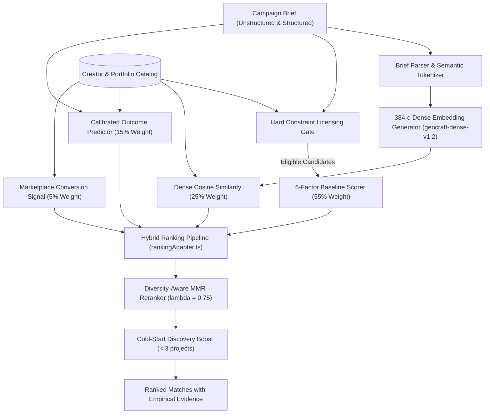

# GenCraft — ML & Recommendation System Architecture

GenCraft combines an explainable 6-factor deterministic baseline with semantic dense vector embeddings, calibrated outcome probability signals, and diversity-aware MMR reranking.

---

## 1. System Pipeline Overview



---

## 2. Representation & Dense Vector Embeddings

### Embedding Model: `gencraft-dense-v1.2`
- **Dimensionality**: 384-dimensional dense float vector.
- **Implementation**: Implemented in [embeddings.ts](../src/lib/ml/embeddings.ts). Operates deterministically using subword character n-gram hashing combined with 32 domain cluster projection centers.
- **Normalization**: Vectors are strictly $L_2$-normalized:
  $$\|\mathbf{v}\|_2 = \sqrt{\sum_{i=1}^{384} v_i^2} = 1.0$$
- **Similarity Computation**: Cosine similarity is computed directly via dot product:
  $$\text{sim}(\mathbf{u}, \mathbf{v}) = \mathbf{u} \cdot \mathbf{v} = \sum_{i=1}^{384} u_i v_i \in [-1.0, 1.0]$$
  Mapped to $[0, 1]$ range for ranking: $\text{sim}_{\text{norm}} = \frac{\text{sim} + 1}{2}$.
- **Design Rationale**: Provides zero-dependency, low-latency ($< 1\,\text{ms}$) deterministic embedding generation that executes identically in browser, Node.js server, and offline test environments without external API quotas or network latency.

### Creator & Portfolio Representation
A creator document is indexed into a rich multi-attribute text representation encompassing:
1. Specialization and headline.
2. Verified tools (e.g., `Veo`, `Kling`, `Sora`, `Flux.1`).
3. Core skills and production workflows.
4. Active portfolio items (titles, descriptions, categories, visual styles, and target audiences).
5. Geographic location and spoken languages.

---

## 3. Candidate Retrieval & Licensing Hard Constraint Gate

Before mathematical ranking occurs, candidates must pass the **Licensing Compatibility Gate** ([licensing.ts](../src/lib/licensing.ts)):
- **Scope Verification**: Prevents assigning `Editorial Only` creators to briefs requiring `Commercial Licensed`.
- **Territory Bounds**: Flags conflicts when a brand requires `Worldwide` rights but creator restricts to `Domestic (India)`.
- **Channel Rights**: Verifies rights for `Paid Advertising` vs. `Organic Social`.
- **Exclusivity**: Detects category exclusivity requirements against non-exclusive creator licensing models.
- **Gate Output**: Candidates with hard legal mismatches are filtered out or flagged as `MISMATCH` with actionable discrepancy notes.

---

## 4. The 6-Factor Baseline Scoring Model

The explainable baseline model ([matching.ts](../src/lib/matching.ts)) evaluates 6 normalized factors (0–100):

| Factor | Weight | Evaluation Criteria |
| :--- | :---: | :--- |
| **Content Fit** | 25% | Direct alignment of creator specialization, categories, and bio to campaign format and audience. |
| **Style & Format** | 20% | Aesthetic match (e.g., Cinematic, Cyberpunk, Photorealistic, High-Speed) and media format compatibility. |
| **Skills & Tools** | 15% | Jaccard overlap between brief required tools and creator certified toolstack. |
| **Portfolio Evidence** | 20% | Verifiable completed projects matching brief themes, target demographics, and keywords. |
| **Trust & Verification** | 10% | Safety audits, audited checkpoint tiers, completion rate, and identity verification. |
| **Licensing Compatibility** | 10% | Terms overlap across duration, territory, channels, and exclusivity. |

### Grounded Empirical Explanations
Every score produces 2 to 4 transparent, data-backed reasons directly citing verified creator attributes (e.g., *"Matched certified AI tools: Veo, Kling"*, *"Portfolio project 'Urban Beats' validates 9:16 vertical commercial delivery"*). When no strong match is found ($< 40\%$), the engine generates constructive parameter relaxation advice.

---

## 5. Hybrid ML Ranking Pipeline

The hybrid ranking pipeline ([rankingAdapter.ts](../src/lib/ml/rankingAdapter.ts)) integrates multiple signals:

$$\text{FinalScore} = 0.55 \cdot S_{\text{baseline}} + 0.25 \cdot S_{\text{semantic}} + 0.15 \cdot S_{\text{outcome}} + 0.05 \cdot S_{\text{conversion}}$$

Where:
- $S_{\text{baseline}}$: Normalized 6-factor score ($0–1$).
- $S_{\text{semantic}}$: Cosine similarity of 384-d dense embedding against creator profile ($0–1$).
- $S_{\text{outcome}}$: Composite predicted outcome probability ($0–1$).
- $S_{\text{conversion}}$: Historical interaction conversion rate ($0–1$).

---

## 6. Diversity-Aware MMR Reranking & Cold-Start Boost

### Maximal Marginal Relevance (MMR)
To prevent the top results from being monopolized by creators with identical styles or toolsets, GenCraft applies MMR reranking ([personalization.ts](../src/lib/ml/personalization.ts)):

$$\text{MMR}(c) = \arg\max_{c \in R \setminus S} \left[ \lambda \cdot \text{Score}(c) - (1 - \lambda) \max_{s \in S} \text{Sim}(c, s) \right]$$

With $\lambda = 0.75$, balancing high relevance with diversity across creative styles and AI tool combinations.

### Cold-Start Discovery Boost
New creators with fewer than 3 completed campaigns receive a calibrated exploration boost (+5% to +8% discovery weight) when their verified skills match brief requirements. This prevents established creators from permanently starving new talent of initial impressions.

---

## 7. Calibrated Campaign Outcome Prediction

Implemented in [outcomePrediction.ts](../src/lib/ml/outcomePrediction.ts), the outcome predictor calculates probabilistic estimates for:
1. $p(\text{Acceptance})$: Probability the creator will accept the proposed brief based on current capacity, turnaround history, and budget alignment.
2. $p(\text{On-Time Delivery})$: Probability of meeting project deadlines based on historical delivery timelines and pipeline complexity.
3. $p(\text{Quality Pass})$: Probability that submitted deliverables pass automated binary delivery checks without specification overruns.

### Data Sufficiency Gating
If a creator has zero completed projects or platform history, the model returns:
```json
{
  "status": "INSUFFICIENT_HISTORICAL_DATA",
  "disclaimer": "Predictions require historical platform interactions. Showing baseline heuristic estimates."
}
```
Probabilities are never fabricated without grounding.

---

## 8. Marketplace Interaction Telemetry

The telemetry pipeline tracks 12 discrete marketplace events via [MarketplaceEvent.ts](../src/lib/models/MarketplaceEvent.ts):
- `SEARCH_SUBMITTED`, `RESULT_IMPRESSION`, `CREATOR_VIEWED`, `PORTFOLIO_ITEM_CLICKED`
- `PROPOSAL_SENT`, `CREATOR_ACCEPTED`, `CREATOR_DECLINED`
- `DELIVERY_SUBMITTED`, `DELIVERY_PASSED_CHECK`, `DELIVERY_APPROVED`, `COMPLETED`, `DISPUTE_OPENED`

Telemetry records aggregate into rolling creator conversion metrics, feeding the hybrid ranker and outcome calibration models.

---

## 9. Offline Recommendation Evaluation Suite

The offline evaluation engine ([evaluation.ts](../src/lib/ml/evaluation.ts)) benchmarks the Baseline 6-Factor model against the Hybrid ML model across 5 real evaluation brief profiles.

### Evaluation Metrics
- **Normalized Discounted Cumulative Gain (NDCG@10 & NDCG@5)**: Measures ranking quality by penalizing relevant items appearing lower in the result list.
- **Recall@3 & Precision@3**: Measures whether top relevant creators appear in the initial 3 results.
- **Mean Reciprocal Rank (MRR)**: Measures how early the first highly relevant creator is found.
- **Catalog Coverage %**: Measures percentage of active catalog creators recommended across queries.
- **Latency**: Measures end-to-end recommendation latency in milliseconds.

### Running Live Evaluation
```bash
# Query the live endpoint
curl http://localhost:3000/api/ml/evaluation
```
Or execute through the test runner:
```bash
npx tsx tests/run-all.ts
```
