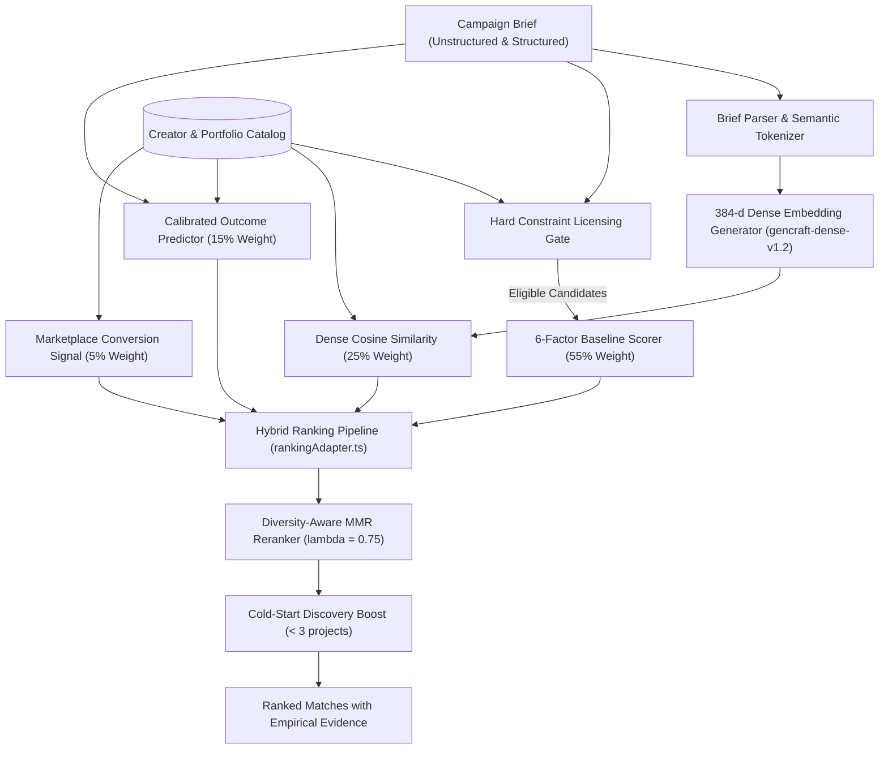
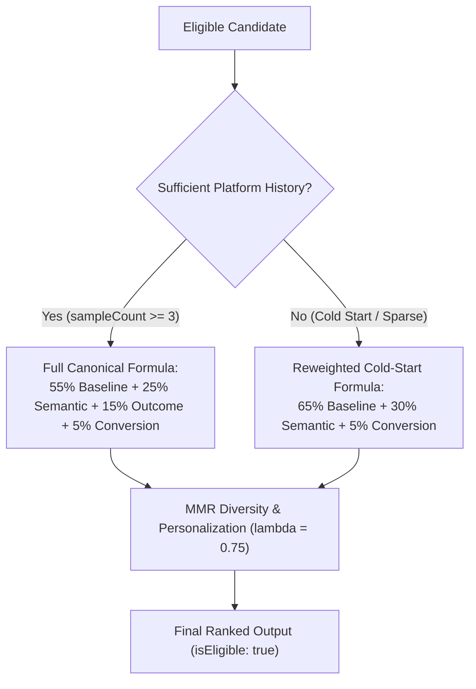
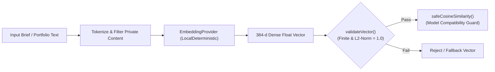
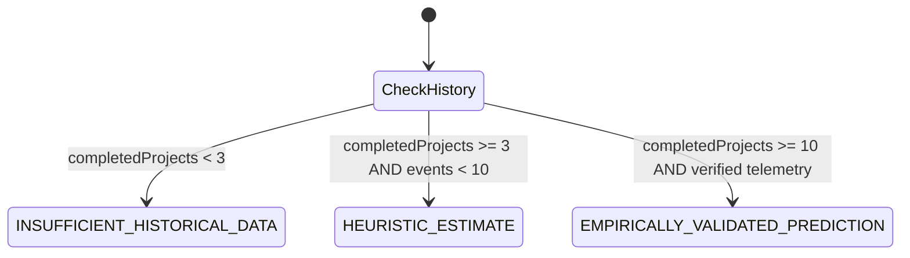

# GenCraft — ML & Recommendation System Architecture

GenCraft combines an explainable 6-factor deterministic baseline with semantic dense vector embeddings, calibrated outcome probability signals, and diversity-aware MMR reranking.

---

## 1. System Pipeline Overview



---

## 2. Representation & Dense Vector Embeddings

### Embedding Model: `gencraft-dense-v1.2`
- **Dimensionality**: 384-dimensional dense float vector.
- **Implementation**: Implemented in [embeddings.ts](../src/lib/ml/embeddings.ts). Operates deterministically using subword character n-gram hashing combined with 32 domain cluster projection centers.
- **Normalization**: Vectors are strictly $L_2$-normalized:
  $$\|\mathbf{v}\|_2 = \sqrt{\sum_{i=1}^{384} v_i^2} = 1.0$$
- **Similarity Computation**: Cosine similarity is computed directly via dot product:
  $$\text{sim}(\mathbf{u}, \mathbf{v}) = \mathbf{u} \cdot \mathbf{v} = \sum_{i=1}^{384} u_i v_i \in [-1.0, 1.0]$$
  Mapped to $[0, 1]$ range for ranking: $\text{sim}_{\text{norm}} = \frac{\text{sim} + 1}{2}$.
- **Design Rationale**: Provides zero-dependency, low-latency ($< 1\,\text{ms}$) deterministic embedding generation that executes identically in browser, Node.js server, and offline test environments without external API quotas or network latency.

### Creator & Portfolio Representation
A creator document is indexed into a rich multi-attribute text representation encompassing:
1. Specialization and headline.
2. Verified tools (e.g., `Veo`, `Kling`, `Sora`, `Flux.1`).
3. Core skills and production workflows.
4. Active portfolio items (titles, descriptions, categories, visual styles, and target audiences).
5. Geographic location and spoken languages.

---

## 3. Candidate Retrieval & Licensing Hard Constraint Gate

Before mathematical ranking occurs, candidates must pass the **Licensing Compatibility Gate** ([licensing.ts](../src/lib/licensing.ts)):
- **Scope Verification**: Prevents assigning `Editorial Only` creators to briefs requiring `Commercial Licensed`.
- **Territory Bounds**: Flags conflicts when a brand requires `Worldwide` rights but creator restricts to `Domestic (India)`.
- **Channel Rights**: Verifies rights for `Paid Advertising` vs. `Organic Social`.
- **Exclusivity**: Detects category exclusivity requirements against non-exclusive creator licensing models.
- **Gate Output**: Candidates with hard legal mismatches are filtered out or flagged as `MISMATCH` with actionable discrepancy notes.

---

## 4. The 6-Factor Baseline Scoring Model

The explainable baseline model ([matching.ts](../src/lib/matching.ts)) evaluates 6 normalized factors (0–100):

| Factor | Weight | Evaluation Criteria |
| :--- | :---: | :--- |
| **Content Fit** | 25% | Direct alignment of creator specialization, categories, and bio to campaign format and audience. |
| **Style & Format** | 20% | Aesthetic match (e.g., Cinematic, Cyberpunk, Photorealistic, High-Speed) and media format compatibility. |
| **Skills & Tools** | 15% | Jaccard overlap between brief required tools and creator certified toolstack. |
| **Portfolio Evidence** | 20% | Verifiable completed projects matching brief themes, target demographics, and keywords. |
| **Trust & Verification** | 10% | Safety audits, audited checkpoint tiers, completion rate, and identity verification. |
| **Licensing Compatibility** | 10% | Terms overlap across duration, territory, channels, and exclusivity. |

### Grounded Empirical Explanations
Every score produces 2 to 4 transparent, data-backed reasons directly citing verified creator attributes (e.g., *"Matched certified AI tools: Veo, Kling"*, *"Portfolio project 'Urban Beats' validates 9:16 vertical commercial delivery"*). When no strong match is found ($< 40\%$), the engine generates constructive parameter relaxation advice.

---

## 5. Canonical Hybrid ML Ranking Pipeline (`gencraft-canonical-hybrid-v2.2`)

The canonical hybrid ranking pipeline ([rankingAdapter.ts](../src/lib/ml/rankingAdapter.ts)) integrates multiple signals with mathematically transparent reweighting:

### Full Information Formula (When Verified Historical Outcomes Exist)
$$\text{FinalScore} = 0.55 \cdot S_{\text{baseline}} + 0.25 \cdot S_{\text{semantic}} + 0.15 \cdot S_{\text{outcome}} + 0.05 \cdot S_{\text{conversion}}$$

### Cold-Start / Insufficient Data Formula (When Historical Outcomes Are Unavailable)
$$\text{FinalScore} = 0.65 \cdot S_{\text{baseline}} + 0.30 \cdot S_{\text{semantic}} + 0.05 \cdot S_{\text{conversion}}$$

Where:
- $S_{\text{baseline}}$: Grounded 6-factor score ($0–100$).
- $S_{\text{semantic}}$: Cosine similarity of 384-d dense embedding normalized to $[0, 100]$.
- $S_{\text{outcome}}$: Composite predicted outcome score from verified engagements ($0–100$). Missing predictions are never fabricated as 0.85/0.90; signals are cleanly reweighted.
- $S_{\text{conversion}}$: Historical interaction conversion rate ($0–100$, default 50 for cold start).



### Hard Constraints Are Strictly Hard Constraints
Licensing incompatibility is **never** treated as a minor score deduction. If a creator cannot legally satisfy mandatory campaign requirements (e.g., `Worldwide` buyout required vs. `Domestic` restriction):
1. Candidate is flagged `isEligible: false` with explicit `ineligibleReason`.
2. Candidate's score is capped at $\le 25\%$ (relegated to bottom).
3. Candidate is disqualified from auto-shortlisting and commission proposals.

---

## 6. Vector Embeddings & Provider Compatibility

### Provider Abstraction & Model Compatibility
Implemented in [embeddings.ts](../src/lib/ml/embeddings.ts):
- **Provider Interface**: Defined by `EmbeddingProvider` specifying `name`, `modelName`, `vectorDimension`, and `generateEmbedding`.
- **Default Provider**: `LocalDeterministicEmbeddingProvider` (`gencraft-dense-v1.2`, 384-d).
- **Model Incompatibility Prevention**: `safeCosineSimilarity()` verifies provider and model metadata before comparing vectors. Mismatched vector comparisons are rejected.
- **Vector Validation**: `validateVector()` guarantees finite numeric floats, non-zero Euclidean norm, and strict dimension match ($L_2$-normalized to 1.0).
- **Private Portfolio Exclusion**: Discovery vectors strictly exclude portfolio projects marked `private`.
- **Cache & Invalidation**: In-memory embedding cache with TTL. `invalidateCreatorEmbedding(creatorId)` is called automatically whenever a creator modifies their profile or portfolio.



---

## 7. Campaign Outcome Prediction Modes & Honest Calibration

Implemented in [outcomePrediction.ts](../src/lib/ml/outcomePrediction.ts), predictions are never conflated with verified empirical models unless supported by data.

### Explicit Prediction Modes
1. `INSUFFICIENT_HISTORICAL_DATA`: Returned for cold-start creators ($< 3$ completed projects). No fabricated probabilities are returned.
2. `HEURISTIC_ESTIMATE`: Heuristic baseline calibrated with verified platform evidence factors.
3. `EMPIRICALLY_VALIDATED_PREDICTION`: Activated strictly when verified sample size $\ge 10$ platform engagements exist.



### Confidence Level Gating
- `HIGH`: Requires $\ge 10$ verified historical platform events.
- `MEDIUM`: Requires 5 to 9 completed engagements.
- `LOW`: 3 to 4 completed engagements.
- `INSUFFICIENT_DATA`: Returned for all creators with $< 3$ engagements.

---

## 8. Honest Telemetry Persistence & Fallbacks

Implemented in [eventTracking.ts](../src/lib/ml/eventTracking.ts):
- **Durable Persistence (`persistenceStatus: 'durable'`)**: Event successfully persisted to MongoDB `MarketplaceEventModel`.
- **Buffered Persistence (`persistenceStatus: 'buffered_in_memory'`)**: Returned when MongoDB is unavailable or disconnected. Events are stored in a bounded FIFO memory buffer (max 1,000 entries) and deduplicated by `eventId`. The response explicitly flags that the event is in memory.
- **Failed Persistence (`persistenceStatus: 'failed'`)**: Returned on malformed data or catastrophic buffer exhaustion.

---

## 9. Offline Recommendation Evaluation Suite (`bench-eval-v2.2`)

The offline evaluation engine ([evaluation.ts](../src/lib/ml/evaluation.ts)) runs 7 realistic benchmark queries testing:
1. Telugu Skincare Commercial (Niche regional language + format)
2. B2B Enterprise SaaS Explainer (Tech / corporate tools)
3. Fantasy Game Cinematic Trailer (CGI / VFX styling)
4. Regional Organic Food Brand (Niche culinary / local dialect)
5. Solar Energy Documentary (Editorial / documentary realism)
6. Hard Licensing Constraint Test (Tests zero false positives on license conflicts)
7. Cold-Start Creator Discovery (Evaluates new creator visibility without history)

### Mathematical Edge-Case Fixes
- `computeNDCG()`: When Ideal DCG ($IDCG$) is 0 (no positive relevance items in ground truth), returns `null` and excludes the query from aggregate NDCG averages instead of falsely returning 1.0.
- `computeRecallAtK()`: When ground truth is empty, returns `null` rather than treating empty sets as 100% recall.
- Supports both `Set<string>` and `string[]` inputs without throwing runtime type errors.

### Running Live Evaluation
```bash
# Query the live endpoint
curl http://localhost:3000/api/ml/evaluation
```
Or execute through the test runner:
```bash
npm test
```

